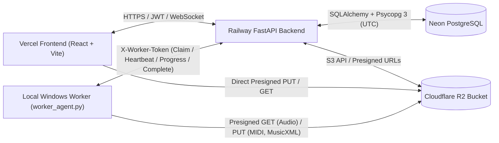

# ScribaSheet – AI Music Transcription Studio

**Turn Audio Into Sheet Music.**

ScribaSheet is a full-stack AI-powered music transcription studio that transforms audio recordings into editable sheet music, MIDI, MusicXML, printable PDFs, and synchronized song lyrics.

---

## A. Application Overview

ScribaSheet supports end-to-end music transcription and arrangement workflows:

1. **Media & Score Ingestion**: Upload MP3, WAV, FLAC, M4A, AAC, MP4, MOV, WEBM audio/video, or choral sheet music (`.pdf`, `.mxl`, `.musicxml`), or record via browser microphone with server-side validation.
2. **AI Transcription & Stem Separation**: Runs a unified transcription core (`app/transcription/core_pipeline.py`) across both the server pipeline and the local Windows worker using Spotify Basic Pitch (ONNX Runtime), optional Transkun for piano, Demucs stem separation (`vocals`, `bass`, `other`), Beat This! beat/downbeat tracking, and `faster-whisper` lyrics recognition.
3. **PDF / MusicXML SATB Separation**: `.mxl` and `.musicxml` files parse directly via `music21` (skipping OMR); `.pdf` scores run OMR via Audiveris CLI (if installed) or `homr` (`backend/.venv_omr`). Supports **Auto-Detect SATB** (4-staff, 2-staff multi-voice/homophonic, and piano-accompanied choral scores) and **Keep Original Staves**, flagging ambiguous voice assignments for review.
4. **Arrangement & Music21 Engraving**: Builds single-instrument, Lead Melody, or 3-staff `Piano + Vocal` scores (`Vocal Melody` treble, `Piano Accompaniment (RH)` treble, `Piano Accompaniment (LH)` bass) with key-aware enharmonic spelling, automatic meter detection (`2/4`, `3/4`, `4/4`, `6/8`), incomplete pickup measure (`Measure 0`, `implicit="yes"`) engraving, contextual Viterbi RH/LH hand assignment, dual performance/notation timing preservation, and dyad-aware chord detection.
5. **Lyrics Transcription & Alignment**: Transcribes vocal lyrics (including English and Tagalog/Filipino), supports inline review/editing with timestamp playback, and aligns syllables (including explicit hyphens and melisma `<extend/>`) directly beneath `Vocal Melody` notes in MusicXML and PDF exports.
6. **Interactive Studio Workspace**:
   - **Sheet Music**: Dual-engine **AlphaTab** (`@coderline/alphatab`) and **OpenSheetMusicDisplay** (`opensheetmusicdisplay`) MusicXML viewers with engine switching, chord-symbol toggle, zoom controls, follow-cursor, Focus Mode, and Light/Dark theme support (`scribasheet-theme`).
   - **SATB / Part Mixer**: Solo, Mute, Volume, Tempo, and voice assignment controls for SATB and multi-part scores.
   - **Piano Roll & Practice Cascade**: Note editing, Snap quantization (`1/16`, `1/8`, `Off`), Undo/Redo, plus an integrated 88-key Synthesia-style Virtual Piano with Web MIDI keyboard input, pitch correction, synchronized MIDI recording, and Web Audio playback (`midiSynth`) protected by a master `DynamicsCompressorNode` and background-tab burst prevention.
   - **Chords & Guitar Tab**: Editable chord symbols and standard-tuning guitar tablature.
   - **Lyrics**: Review filters (`All` / `Needs Review`), inline segment editing, timestamp auditioning, and `.txt`/`.srt`/`.lrc` export.
   - **Export Center**: Export `.mid` (preserving performance timing), `.musicxml`, `.pdf` sheet music, synthesized `.wav`, and individual SATB rehearsal MP3s (`Soprano.mp3`, `Alto.mp3`, `Tenor.mp3`, `Bass.mp3`) stored in R2/local storage.

---

## B. Technology Stack and Architecture

- **Frontend (Vercel)**: React 18, TypeScript, Vite, Tailwind CSS, React Router, TanStack Query, WaveSurfer.js, AlphaTab (`@coderline/alphatab`), OpenSheetMusicDisplay (`opensheetmusicdisplay`), `smplr`, Web Audio API (`midiSynth`), Web MIDI API (`useWebMidi`).
- **Backend API (Railway)**: Python 3.12, FastAPI, Pydantic v2, SQLAlchemy 2.0, Alembic, ReportLab, `music21`, `pretty_midi`, `boto3`.
- **Database (Neon)**: Neon PostgreSQL (`ap-southeast-1`, Psycopg 3) with SQLite fallback for local development and isolated testing.
- **Object Storage (Cloudflare R2)**: S3-compatible private bucket via `boto3` (`STORAGE_BACKEND=r2`), with `STORAGE_BACKEND=local` preserved for local development.
- **Local Windows ML Worker**: `app.worker_agent` & `app.worker_controller` running Basic Pitch (ONNX CPU), optional Transkun, Beat This!, isolated `backend/.venv_demucs` for Demucs + `faster-whisper`, and FFmpeg.

---

## C. Infrastructure and Data Flow



1. **Upload**: Frontend requests a short-lived presigned PUT URL (`POST /api/v1/uploads/presign`) when `STORAGE_BACKEND=r2` (or multipart `POST /api/v1/uploads` when `local`), uploads audio directly to R2, and confirms metadata (`POST /api/v1/uploads/confirm`) in Neon PostgreSQL.
2. **Job Dispatch**: User starts transcription (`POST /api/v1/projects/{id}/transcriptions`). Railway persists the queued `TranscriptionJob` referencing the R2 `storage_path`.
3. **Worker Execution**: `app.worker_agent` polls `POST /api/v1/worker/jobs/claim`, downloads the source audio from R2 via `source_download_url` into a temporary directory, runs Demucs / Basic Pitch / Whisper / Music21, uploads generated `.mid` and `.musicxml` directly to R2 via `artifact_upload_urls`, and submits `score_json` to `POST /api/v1/worker/jobs/{id}/complete`. Temporary local worker files are cleaned up automatically after each job.
4. **Persistence & Retrieval**: Railway records `MediaAsset` and `ProjectScore` references in Neon. Exports (`.mid`, `.musicxml`, `.pdf`, `.wav`) are stored in R2 and served through authenticated endpoints.

---

## D. Storage Configuration

ScribaSheet uses a centralized `StorageService` in [backend/app/storage/service.py](backend/app/storage/service.py).

### Cloudflare R2 (`STORAGE_BACKEND=r2`)
```env
STORAGE_BACKEND=r2
R2_BUCKET_NAME=<your-bucket-name>
R2_ENDPOINT_URL=https://<ACCOUNT_ID>.r2.cloudflarestorage.com
R2_ACCESS_KEY_ID=<your-r2-access-key-id>
R2_SECRET_ACCESS_KEY=<your-r2-secret-access-key>
```
*(Legacy `STORAGE_BACKEND=s3` and `S3_*` aliases remain supported for backward compatibility.)*

### Local Filesystem (`STORAGE_BACKEND=local`)
```env
STORAGE_BACKEND=local
LOCAL_STORAGE_ROOT=./storage_data
```

### Object Key Organization & Persistence
- Project files: `users/{user_id}/projects/{project_id}/{category}/{unique}_{filename}`
- Job artifacts: `users/{user_id}/projects/{project_id}/jobs/{job_id}/{category}/{unique}_{filename}`
- **No silent fallback**: If `STORAGE_BACKEND=r2` fails, `StorageService` raises `StorageError` and logs the error without falling back to local disk or exposing secrets/URLs.
- **No automatic historical migration**: Existing local files and the Railway `/data` persistent volume are preserved untouched until R2 is verified end-to-end in production.

---

## E. Database and Migrations

- **Production**: Neon PostgreSQL (`postgresql+psycopg://...sslmode=require`), normalized automatically in [backend/app/db/session.py](backend/app/db/session.py).
- **Local / Testing**: `sqlite:///./scribasheet.db` (or in-memory SQLite in pytest).
- **Timestamps**: Stored in UTC in PostgreSQL, serialized as explicit UTC ISO-8601 (`Z`) by the API, and formatted in `Asia/Manila` (or `VITE_APP_TIMEZONE`) on the frontend.

Inspect and run migrations from `backend/`:
```powershell
cd backend
.\.venv\Scripts\alembic.exe heads       # Current head: e3a4c19f8b12
.\.venv\Scripts\alembic.exe current
.\.venv\Scripts\alembic.exe upgrade head
```

---

## F. Local Development and Worker Setup (Windows PowerShell)

### 1. Environment Files
- Copy `backend/.env.example` to `backend/.env` and configure `JWT_SECRET_KEY`, `SIGNED_URL_SECRET`, `DATABASE_URL`, `WORKER_API_TOKEN`, and storage variables.
- Copy `frontend/.env.example` to `frontend/.env` (`VITE_API_BASE_URL`, `VITE_WS_BASE_URL`). Never put backend or R2 secrets in `frontend/.env`.

### 2. Backend API Setup
```powershell
cd backend
python -m venv .venv
.\.venv\Scripts\Activate.ps1
pip install -r requirements.txt
pip install --no-deps basic-pitch==0.4.0
.\.venv\Scripts\alembic.exe upgrade head
.\.venv\Scripts\uvicorn.exe app.main:app --reload --port 8000
```

### 3. Isolated Demucs + Whisper & OMR Environments (Local Windows Worker Only)
Demucs/`faster-whisper` (`backend/.venv_demucs`) and `homr` OMR (`backend/.venv_omr`) run in isolated venvs and must stay out of the Railway runtime:
```powershell
# Demucs + faster-whisper
python -m venv backend\.venv_demucs
backend\.venv_demucs\Scripts\python.exe -m pip install demucs faster-whisper "av>=12.0.0,<16.0.0" torch torchaudio soundfile

# Optional OMR for PDF sheet music import (homr, or install Audiveris CLI on PATH / AUDIVERIS_EXECUTABLE)
python -m venv backend\.venv_omr
backend\.venv_omr\Scripts\python.exe -m pip install homr onnxruntime
```
*(Troubleshooting: Direct `.mxl` and `.musicxml` imports skip OMR completely. PDF OMR requires either Audiveris CLI or `homr` in `backend/.venv_omr`; individual SATB `.mp3` exports require `ffmpeg` on `PATH` and optional `fluidsynth` for SoundFont rendering.)*

### 4. Local Windows Worker Agent
```powershell
cd backend
.\.venv\Scripts\Activate.ps1
$env:SCRIBASHEET_API_URL = "https://scribasheet-production.up.railway.app/api/v1"
$env:WORKER_API_TOKEN = "<your-worker-api-token>"
$env:WORKER_ID = "win11-ryzen-home"
python -m app.worker_agent
```

### 5. Frontend Setup
```powershell
cd frontend
npm install
npm run dev
```
Open `http://localhost:5173`. FastAPI interactive docs are at `http://localhost:8000/docs`.

---

## G. Application Features and Recent Improvements

- **3-Staff `Piano + Vocal` Arrangement**: Generates `Vocal Melody` (Treble), `Piano Accompaniment (RH)` (Treble), and `Piano Accompaniment (LH)` (Bass) with a brace `StaffGroup`, `F3–G3` (`53–55`) context-aware RH/LH splitting, `E2–G3` bass roots, and multi-measure accompaniment continuity.
- **Vocal Pitch Continuity & Key Spelling**: Filters sub-bass artifacts (`< G3`) and unsupported extreme upper outliers without clamping pitches, smooths 1-semitone vibrato blips, merges fragmented same-pitch notes (`<= 90ms` gap), and spells accidentals according to the detected key signature.
- **Chord Detection**: Uses isolated Demucs `other` + `bass` stems when available, with minimum window weight filtering and key-signature weighting.
- **Lyrics Transcription & Note Alignment**: Supports Tagalog/Filipino and English syllabification, explicit user hyphens, melisma `<extend/>` in MusicXML, PDF lyric rendering, review filters (`All` / `Needs Review`), inline editing, and immediate Sheet Music synchronization.
- **Piano Roll Virtual Keyboard & Web MIDI**: 88-key Synthesia-style keyboard, `navigator.requestMIDIAccess()` device connection, key-press auditioning, single/multi-note interval-preserving re-pitching, and synchronized MIDI recording with count-in and `1/16` / `1/8` quantization.
- **Studio UI & Timezones**: Live `Elapsed: mm:ss` / `Completed in mm:ss` job runtime badge in `ProjectStudioPage` and standardized `Asia/Manila` date/time display.
- **Cloudflare R2 Integration**: Code and mocked S3/R2 tests are implemented; production R2 readiness requires setting `STORAGE_BACKEND=r2` + `R2_*` on Railway and running an end-to-end upload, worker job, and export verification.

---

## H. Deployment and Operations

- **Vercel (Frontend)**: Set `VITE_API_BASE_URL` and `VITE_WS_BASE_URL` pointing to the Railway API.
- **Railway (Backend API)**: Set `ENVIRONMENT=production`, `JOB_EXECUTION_MODE=remote_worker`, `DATABASE_URL` (Neon pooled URL), `JWT_SECRET_KEY`, `SIGNED_URL_SECRET`, `WORKER_API_TOKEN`, `STORAGE_BACKEND=r2`, and `R2_*` credentials. Keep the `/data` volume mounted until R2 end-to-end verification is complete.
- **Health & Worker Verification**:
  - API & DB health: `GET /api/v1/health`
  - Worker online status: `GET /api/v1/worker/status` (authenticated)

---

## I. Security and Maintenance

- **Secret Isolation**: R2 keys, JWT secrets, and `WORKER_API_TOKEN` live only in Railway / `backend/.env` and are never exposed to the frontend or logged.
- **Authorization & Path Safety**: Every upload, download, and delete checks project/asset ownership; `StorageService` rejects path-traversal keys (`..`, leading `/`).
- **Presigned URLs**: Short-lived (`SIGNED_URL_TTL_SECONDS`, default `900s`) presigned R2 GET/PUT URLs scope access to single object keys.
- **Backups & Retention**: Use Neon point-in-time recovery / snapshots for PostgreSQL metadata and Cloudflare R2 bucket lifecycle/versioning policies for object retention.

---

## Testing & Benchmarking

```powershell
# Backend lint & tests
cd backend
.\.venv\Scripts\ruff.exe check app tests
.\.venv\Scripts\python.exe -m pytest -q

# Backend audio-to-MIDI benchmark (writes JSON & Markdown reports to backend/benchmarks/results/)
.\.venv\Scripts\python.exe -m benchmarks.run_benchmark

# Frontend typecheck, production build & tests
cd frontend
npm run build
npm test -- --run
```

## Social Sharing & Link Previews

Static Open Graph and Twitter/X Card metadata are defined directly in [`frontend/index.html`](frontend/index.html) so social crawlers receive complete preview tags in the initial HTML response:

- **Canonical URL**: `https://scribasheet.vercel.app/`
- **Preview Image**: [`frontend/public/images/og-preview.png`](frontend/public/images/og-preview.png) (`1200×630`, `1.91:1`, served at `https://scribasheet.vercel.app/images/og-preview.png`)
- **Favicons & Touch Icons**: `/favicon.svg`, `/favicon-32x32.png`, and `/apple-touch-icon.png`

After deploying to Vercel, validate link previews using:
- [Facebook Sharing Debugger](https://developers.facebook.com/tools/debug/)
- [LinkedIn Post Inspector](https://www.linkedin.com/post-inspector/)
- X/Twitter Card preview tools (note: Instagram feed captions do not generate clickable Open Graph link previews; use the brand assets for Stories/bio links).

## Documentation Index

- [Implementation Plan](docs/IMPLEMENTATION_PLAN.md)
- [Architecture Decisions](docs/ARCHITECTURE_DECISIONS.md)
- [System Architecture](docs/ARCHITECTURE.md)
- [API Reference](docs/API.md)
- [Database Schema](docs/DATABASE.md)
- [Transcription Pipeline](docs/TRANSCRIPTION_PIPELINE.md)
- [Transkun Integration](docs/transkun-integration.md)
- [Deployment Guide](docs/DEPLOYMENT.md)
- [Security & Privacy](docs/SECURITY.md)
- [Testing Guide](docs/TESTING.md)
- [User Guide](docs/USER_GUIDE.md)
